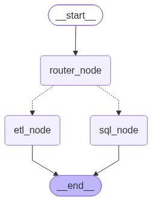

# Data Agent Project

An experimental Python project for exploring data workflows with LangChain, LangGraph, and Groq. The agent graph routes a user's request toward an ETL workflow or a natural-language-to-SQL workflow. The repository also includes sample ride-sharing data and a PostgreSQL loader.

> **Project status:** This is an early-stage prototype, not a production-ready data agent. The SQL workflow is incomplete, and the ETL transformation path executes Python code generated by an LLM. Do not use it with untrusted requests or sensitive data.

## What it includes

- **Request routing:** A Groq model classifies requests as ETL or SQL.
- **ETL prototype:** Extracts API data and supports transformation/load operations for CSV, JSON, and Parquet files.
- **SQL prototype:** Curates natural-language questions, builds context from a PostgreSQL schema, and drafts SQL. The query-execution integration is not complete.
- **PostgreSQL sample dataset:** CSV files and a loader for a ride-sharing schema.
- **LangGraph workflows:** Graph-based routing and agent workflows.

The high-level router graph is shown below:



## Technology

- Python 3.13+
- LangChain and LangGraph
- Groq API (`langchain-groq`)
- PostgreSQL and `psycopg2`
- Pandas for data transformations

## Repository layout

```text
.
├── agents/
│   ├── data_agent.py       # Routes requests to ETL or SQL workflows
│   ├── etl_analyst.py      # ETL agent and tool definitions
│   └── sql_analyst.py      # Experimental SQL agent graph
├── data/
│   ├── *.csv               # Sample ride-sharing tables
│   └── extract/            # Example extracted data
├── models/schema.py        # Pydantic state schemas
├── src/data_agent_project/ # Packaged console entry point
├── utils/
│   ├── database.py         # PostgreSQL helper
│   ├── etl_tools.py        # Extract and transform helpers
│   └── llm_pick.py         # Groq model selection
├── feed_db.py              # Creates tables and loads sample CSVs
├── main.py                 # Runs a fixed ETL demonstration request
├── schema_details.txt      # Example database schema context
└── pyproject.toml          # Project metadata and dependencies
```

## Getting started

### Prerequisites

- Python 3.13 or newer
- [uv](https://docs.astral.sh/uv/) (recommended)
- A Groq API key for the agent workflows
- PostgreSQL for loading the sample dataset and experimenting with the SQL workflow

### Install dependencies

Clone the repository and change into its directory, then install the project dependencies:

```bash
uv sync
```

Alternatively, create and activate a virtual environment and install from `requirements.txt`:

```powershell
py -3.13 -m venv .venv
.venv\Scripts\Activate.ps1
pip install -r requirements.txt
```

For macOS or Linux, activate the environment with:

```bash
source .venv/bin/activate
```

### Configure credentials

Create a `.env` file in the repository root. Use your own PostgreSQL connection details and Groq API key:

```dotenv
host=localhost
port=5432
database=your_database_name
user=your_database_user
password=your_database_password
GROQ_API_KEY=your_groq_api_key
```

Keep this file private. It is excluded from Git by `.gitignore`. The PostgreSQL values are used by the database loader and SQL workflow; the Groq key is used by the language-model components.

## Run the project

Run the current demonstration from the repository root:

```bash
uv run python main.py
```

`main.py` submits a fixed request to extract data from the public Pokémon API. A Groq API key is required. The current implementation also initializes database-related modules during import, so a local PostgreSQL connection may be attempted even for this ETL demonstration.

The `data-agent-project` console command currently runs a placeholder greeting; use `main.py` for the graph demonstration.

## Load the sample PostgreSQL data

Create a PostgreSQL database, configure the database variables in `.env`, then run:

```bash
uv run python feed_db.py
```

The loader creates the tables and indexes in the `public` schema and imports `users.csv`, `vehicles.csv`, `rides.csv`, `payments.csv`, and `ratings.csv` from `data/`.

> **Warning:** Each run truncates these five tables before loading the CSV data. Do not run this against a database containing records you need to keep.

### Sample schema

| Table | Description |
| --- | --- |
| `users` | Rider and driver profile information |
| `vehicles` | Vehicles associated with drivers |
| `rides` | Ride participants, timing, locations, fares, and status |
| `payments` | Payment details associated with rides and users |
| `ratings` | Ride feedback and one-to-five ratings |

Foreign keys connect related records, and indexes support common lookups by rider, driver, ride, status, and timestamp. See [`schema_details.txt`](schema_details.txt) for a sample schema description.

## Current limitations

- The SQL workflow is a prototype; database query execution is not fully implemented.
- The ETL transformation tool runs LLM-generated Python code with `exec`. Treat this as unsafe for untrusted input; the SQL safety-judge step is also not a substitute for database permissions or other security controls.
- The packaged `data-agent-project` command is still a placeholder.
- Database utilities currently perform work during module import, which can attempt a connection before a workflow is run.

These limitations are documented to make the current behavior clear; do not treat the project as a secure or complete data-processing service.

## Contributing

Contributions and issue reports are welcome. Please include a clear description of the change and steps to reproduce any reported bug. Avoid committing credentials, personal data, or generated output containing sensitive information.

## Author

**Muskan Kumar**

## License

No license is currently included in this repository. Until one is added, reuse and redistribution are not granted by this README.
